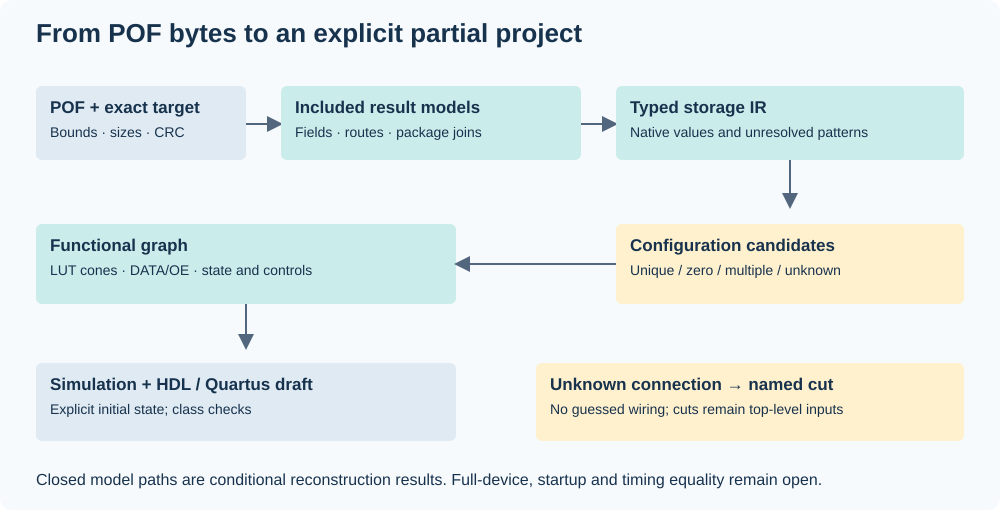

# Architecture and IR contracts

The runtime uses an included read-only SQLite model database and Python's
standard library. Exact target/geometry checks precede field interpretation.
Model content hashes and lengths detect accidental changes to included data;
they are not original-input identities or functional-equivalence certificates.

## Three views of the same input

| View | Command | Meaning |
| --- | --- | --- |
| Storage | `decode` | Native field terms, serialized/normalized values, exclusions and sentinels |
| Configuration candidates | `analyze` | Route match sets, channel roles and bounded control patterns |
| Functional partial graph | `reconstruct` | LUT/register/pin expressions and explicit unknown interfaces |

The parser snapshots input bytes once. File positions, CFM/UFM payload offsets,
native addresses and logical ports remain distinct. LUT ordinal storage cannot
be used as a logical-minterm table without its separate transform.

## Functional graph

`cells` binds native LC identities to truth masks and input expressions.
`registers` records D, clock pin/edge, Clear, Load, async data and Enable.
`pins` separates DATA from OE and records push-pull/open-drain drive behavior.
`inputs` denotes sampled external pad values. `boundaries` gives stable IDs,
native identities and reasons for unresolved dependencies.

Expressions include constants, sampled input pins, LUT/cell results, register
state, inversion and named boundaries. A repeated unknown native identity shares
an interface. Unsupported state dependencies and combinational cycles are cut
explicitly, never replaced by a guessed constant or connection.

Class checks validate expression shape, binary domains, uniqueness, topology,
budgets and admitted control/event restrictions. `assessment` reports closed
driven output paths, registers and unresolved interfaces separately. Released
pins and constant drive relations do not count as recovered logic paths.

## Emission and evaluation

`emit-project` renders a core with sampled-pad inputs, open-interface inputs and
DATA/OE outputs, plus a bidirectional-pad wrapper. State uses `maxv_lcell` where
changing asynchronous data needs primitive semantics. Device and source-file
settings are emitted. `--bind-pins` optionally applies checked exact-target
package joins or included serial-UFM recipe pin maps. Physical LC placement,
startup state and timing assumptions are not inferred.
Pin-bound drafts also consume qualified exact-site I/O options when present;
conflicts stop emission and unsupported sites remain diagnostic. ALOAD support
graphs and retained-topology masks are separate typed support artifacts, not
substitutes for a closed functional graph.

`simulate` evaluates an explicit model with caller-supplied state and stimulus.
The current state model admits settled binary single-input events. It samples
clocked updates from the same prior state, then settles qualified asynchronous
consumers. It rejects unsupported simultaneous events and inconsistent initial
async state. This verifies the supplied model's behavior under its assumptions.

Core schema names retain `maxvrec.*` prefixes where they identify existing data
contracts. They do not require another Python package or repository. Public
envelopes and manifests use `maxvell.*`.

[Development entry points and extension workflow](../CONTRIBUTING.md).
For new observations, use [controlled Quartus experiments](QUARTUS_CONTROL.md)
and [explicit proof scope](EXPERIMENTS.md); an accepted assignment or fitted
cell identity alone does not establish a semantic transform.
