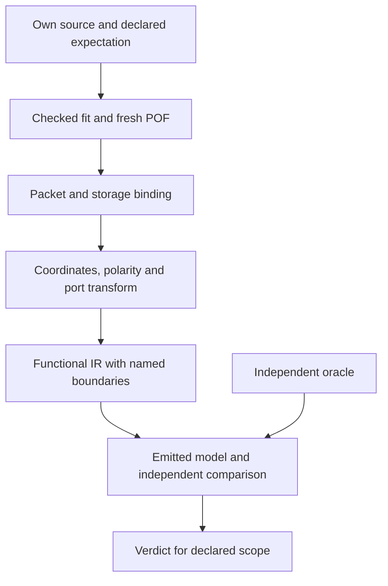

# Experiments that establish a result

Begin with one observable function that a decoder or reconstructor can consume.
Decide what would falsify the proposed interpretation before compiling. A useful
experiment eliminates an alternative explanation or closes a named functional
boundary; more changed bits alone need not achieve either.

Experiments can give a formal result **within explicit assumptions and a closed
model**. Finite observations of a black box cannot prove unrestricted device
behavior or that an unconsidered explanation is impossible. Keep that distinction
in the claim, the tests and the documentation.

The [included candidate inventory](CANDIDATES.md) provides concrete research
starting points, their present limits and retained negative results.

## Define the claim before collecting data

Write a short claim containing:

- **Object and scope:** exact part/package, compiler version, mode, relevant
  resources/ports, admitted initial state and event class.
- **Statement:** the mapping or behavior, with its quantifier. For example,
  “for every one of the 16 binary input combinations, this fixed four-input LUT
  with these port bindings implements XOR.”
- **Assumptions:** the connections, field transforms, model class and oracle on
  which the statement depends. Identify what is already established and what
  the experiment itself must establish.
- **Competitors and discriminator:** alternative input permutations, polarity,
  selectors, control priority, shared routing or compiler transformations, and
  an input/setting where their predictions differ.
- **Acceptance and stop:** exact expected observations; what counts as pass,
  failure or unresolved, including uncontrolled fit changes.

“It matches the examples” is a compatibility result. “It is the only model”
requires an explicitly defined candidate class and evidence that distinguishes
every remaining candidate. If two candidates predict all available observations
equally, retain the ambiguity and design a new discriminator.

For a concrete multi-cell discriminator, an own function such as
`f = (a & b) ^ (c & d) ^ e` depends on five independent binary inputs. Check all
32 combinations and demonstrate the influence of each input. Confirm at least
two reachable fitted cells in the output cone. This excludes an implementation
by one ordinary four-input LUT under that model; it does not exclude special
modes or additional control resources without checking them. Merely adding a
second unused cell does not demonstrate functional cone composition.

## A small, controlled experiment sequence

1. **Baseline A:** build the smallest own design that exposes the chosen behavior.
   Record source, target, settings, fitted nodes, pin/cell identities and output.
2. **Treatment B:** change one factor. If several controls must change together,
   name the bundle and restrict the claim to its combined effect. Additional
   variants are needed to attribute a result to one member of the bundle.
3. **Negative/discriminator case:** use a case that competing models predict
   differently, or a case that must be rejected. A positive case alone can leave
   a swapped input, active-low control or constant function undetected.
4. **Repeat A when stability matters:** rebuild in an independent directory with
   the same recorded inputs. A-B-A checks repeatability; it does not remove an
   unmeasured confounder or create new functional coverage.
5. **Inspect the fitted implementation:** confirm the nodes, legal pins, LC
   locations, port order and resource class that the comparison requires. Stop
   if a required lock is ignored or the implementation changes outside scope.
6. **Fresh decode and independent comparison:** decode the newly assembled POF;
   compare the relevant function with an oracle that does not reuse the same
   untested transform. Record unresolved interfaces explicitly.
7. **Verdict:** report pass/fail/unresolved for the declared scope, with the
   alternatives excluded, remaining assumptions and any counterexample.

Use [the Quartus control guide](QUARTUS_CONTROL.md) for the practical fitting
steps. Equal seeds do not freeze routing. Even equal LC positions can conceal a
different route or input order. An uncontrolled change does not make a POF XOR
meaningless, but it prevents attributing that XOR uniquely to the intended factor.

## What can be proved exhaustively?

| Proposed result | Sufficient comparison within the stated model | What it does not establish |
| --- | --- | --- |
| One fixed, closed four-input combinational LUT | Enumerate all 16 binary inputs; independently establish the physical-to-logical input order and output polarity; compare every output | Other LUT locations/modes, hidden controls, electrical effects, hazards or timing |
| A bit-to-field binding | Observe both values under controlled context, test polarity/order and reject competing selectors; use mixed patterns to check interaction where relevant | Functional meaning merely from a changed offset |
| A multi-bit linear mapping | State and justify linearity/context independence; establish the basis and validate mixed patterns/discriminators | Basis or one-hot probes alone do not prove that an unknown black box is linear |
| A finite sequential model | Establish its state representation and initial-state scope; compare the complete transition/output table for **every admitted state/event**, including edge, hold and control priority | Unmodeled startup, simultaneous events, metastability, analog timing or unsupported state/control classes |
| An emitted partial project | Compare every admitted input/state/event of its closed model with an independent reference, preserving the same open-interface contract | The environment of unknown interfaces or whole-original-input equivalence |
| A fitted or hardware result | Add matching fit/netlist or measured hardware observations and specify stimuli, timing, reset and instrument assumptions | General equivalence beyond those observations without a complete formal model and argument |

For a finite model with domain `D`, the formal obligation is
`for every x in D: recovered(x) = reference(x)` under recorded assumptions `C`.
For stateful models, `x` includes the current state and an admitted event, and
both next state and output must agree. Domain completeness and correct mapping
to the physical implementation are part of the obligation, not consequences
of a successful test runner.

The current sequential evaluator admits settled binary states and bounded
single-input events. A short sequence is an example; exhaustive transitions
would be a stronger result **only for that admitted model**. Do not silently add
simultaneous independent events or assumed power-up values. See
[reconstruction boundaries](RECONSTRUCTION.md).

Compare repeat baselines and account for known cochanges before assigning meaning
to residual bits. Reserve a distinguishing case not used to fit the hypothesis;
keep null and contradictory results. Correlation, symmetry and a smaller residual
set can prioritize candidates but do not establish field semantics. Prefer the
next small discriminator over a larger inventory with the same ambiguity.

For DATA/OE attribution, keep both source pins and both output primitives present
in baseline and treatment, swapping only source-to-sink associations. Removing
a source also changes IOC presence and confounds the result. Confirm fitted
identities, DATA/OE bindings and paths in both cases; use asymmetric functions
and negative controls. An accepted assignment or changed POF bit alone does not
establish the source relation.

The vendor simulation atom is not automatically a design-entry primitive.
For example, `cin0/cin1/cout0/cout1` in `maxv_atoms.v` were not valid source
ports for Quartus II 13.1 `maxv_lcell`. Use the installed compiler's primitive
declaration and verify the resulting cells. Trivial buffers/inverters can fold
into I/O despite preservation controls; use a distinguishable multi-input
function when the experiment needs a physical LUT, and inspect the final fit.

## Independence of the oracle

Useful oracles include a hand-derived truth table for a small function, an
independent simulator/model with explicit reset and stimulus, or observed behavior
of an own fitted design. Each has a scope: HDL simulation alone does not establish
POF decoding or the fitted physical realization; a fitted netlist alone does not
measure hardware.

A decoder and encoder can round-trip while sharing the same wrong permutation.
Likewise, expected and actual outputs generated by the same helper can agree
without testing that helper. Keep the oracle's construction separate from the
interpretation under test. Reusing independently checked infrastructure is fine;
list the shared assumptions instead of calling the entire chain independent.

For output functions, compare the dependency graph and DATA/OE relation as well
as output values. All-zero/all-one input patterns can miss permutations and
feedback mistakes. Test asymmetrical patterns, active-low controls, priority
conflicts and cases in which an unsupported model must remain unresolved.

## Keep the evidence chain explicit



Do not collapse packet offsets, native bits, native coordinates, Quartus
`LC_X/Y/N`, logical LUT minterms and package pins into one identity. Each join
needs its own established transform. A correct CRC establishes file consistency,
not these transforms or the function. Bit identity is useful diagnosis; functional
equivalence can survive harmless bit differences, while similar bits can hide
different behavior.

Keep a small receipt alongside own sources and checks. A Markdown note plus
machine-readable measurements is sufficient; a new campaign framework is not
required. A contribution can use this template:

```text
Claim / exact scope / assumptions:
Baseline and treatment; factor or explicit bundle:
Competing explanations and distinguishing case:
Oracle and shared dependencies:
Tool version / exact target / relevant fitted nodes and ports:
Source, settings, stimulus, POF and result SHA-256:
Expected / observed / counterexamples:
Verdict: pass | fail | unresolved, limited to ...
Remaining boundaries and next useful discriminator:
```

Retain raw local logs/reports under ignored `work/`. Publish small own reproductions,
factual observations and the evidence needed to evaluate the claim. Do not commit
personal paths/identifiers, third-party input designs or bulk vendor data. Link
external tools/manuals instead; see [contribution material](../CONTRIBUTING.md#material-to-submit)
and [provenance](PROVENANCE.md). Do not relabel an acquisition method as independent
observation if it used another method.

### A useful artifact set

| Artifact | What to compare | Remaining limit |
| --- | --- | --- |
| HDL, QPF/QSF and SDC | Source, exact target, settings and declared constraints | An assignment may be ignored or fail to control the final fit. |
| Fresh POF and assembler report | Payload/hash and generation result | Neither establishes all field meanings or equivalent function. |
| Pin, synthesis and fit reports | Actual pins, surviving nodes, cells and messages | Equal locations do not establish equal routes or LUT port order. |
| RCF and fitted route observations | Requested paths versus realized resources and physical ports | Check every requested path; compilation can succeed after fallback. |
| Exported post-fit netlist | Independent function comparison under declared stimuli | Untimed simulation does not establish hardware, hazards or startup. |
| STA report | Timing under the supplied constraints | Missing or incorrect constraints remain assumptions. |
| Fitted database (`db/`, `incremental_db/`) | Local inspection and saved ECO state with the matching tool | This is version-specific state, not a public interchange format or a MAXVell runtime dependency. |

Keep bulky reports/databases locally. A compact own receipt should identify the
decisive observations and hashes, including failed cases. See the
[routing and ECO workflow](QUARTUS_CONTROL.md#routing-and-saved-eco-experiments).

## Contradictions and promotion

If a result contradicts the claimed model, retain the counterexample, stop its
promotion and locate the first failing join: uncontrolled compile, packet/bit
binding, coordinate/port transform, functional interpretation or oracle. Do not
discard the case, vote over inconsistent models, or weaken the test to make the
claim pass. A bounded correction needs a rerun of affected checks and a revised
claim if its scope changed.

| Evidence state | Suitable statement |
| --- | --- |
| Several explanations remain | Candidate interpretation; list alternatives |
| Storage values and ordering checked | Decoded field/storage mapping for the stated context |
| Closed functional model independently checked | Functional interpretation for the admitted class/domain |
| New input freshly decoded and compared | Exact-input comparison with stated boundaries |
| New emitted design fitted or tested in hardware | Additional fit/hardware result for that exact artifact and conditions |

These levels are not interchangeable. A database entry is not proof merely
because the runtime accepts it. A checked example is not a grant for every
configuration, device family or future emitted project.
Likewise, a field label or debug scalar does not establish the effective control
path. An asynchronous-load interpretation still needs the admitted local/LAB
class, source relation, priority and event semantics. Retain unresolved
combinations rather than promoting a label into a connection; see
[control candidates](CANDIDATES.md).

## Dos and don'ts

| Do | Avoid |
| --- | --- |
| Start with a function and a named downstream consumer | Accumulating bit coverage without a functional question |
| Choose asymmetric stimulus that separates hypotheses | Only zero/one patterns or symmetric XOR to establish input permutation |
| Check synthesis and final fit independently | Treating accepted `keep` or a seed as a physical freeze |
| Use actual fitted names and legal exact-target coordinates | Guessing node names, package compatibility or coordinate transforms |
| Check Clear/Load/Enable priority and rejected event cases | Assuming a few clock toggles establish every state-control mode |
| Keep unknown dependencies as named interfaces | Filling unknown connections with zero or plausible wiring |
| Preserve contradictory cases and unique artifact identities | Duplicating cases to increase counts or removing inconvenient evidence |
| Re-run affected checks after a transform or emitter change | Reusing an old compile as proof for a new emitted design |
| Separate storage, function, timing and hardware claims | Equating CRC, bit round trip or successful compilation with all of them |

## Current boundaries and paths that do not close them

| Area | Unproductive shortcut | Useful next experiment |
| --- | --- | --- |
| Register cone composition | Declaring every fitted register recovered because its LC was found | In the control example, isolate the unresolved `q1` dependency and distinguish the required data-cone composition; currently one of two visible output paths closes. |
| LUT order and coordinates | Treating native LUT bits as named Quartus input ports | Use an asymmetric truth table and checked fitted port bindings for the exact location/context. |
| Carry/arithmetic or cascade | Extending an ordinary LUT/feedback model without class checks | Isolate the mode, boundaries and truth/state behavior; retain rejection until its own consumer is established. |
| Derived or unqualified clocks | Using a decoded selector as a proved clock source and edge | Establish source, inversion and event behavior separately before state emission. |
| Startup and multiple asynchronous events | Inferring them from the current settled single-event evaluator | Define initial-state/event semantics and an independent discriminator; these remain outside current admission. |
| UFM behavior | Generalizing nine accepted recipes to arbitrary UFM circuitry | Check the specific instance, controls, content order and observable function of a new recipe. |
| Device-family breadth | Copying a map between parts or equating nominal LC count with native capacity | Check exact geometry, package binding and the functional transforms used by that family. |
| Optimization reversal | Searching a POF for uniquely recoverable eliminated RTL | Regenerate own source under checked controls; retain alternative equivalent decompositions when the original information is absent. |
| Global reconstruction | Treating a partial graph or empty unknown list as whole-input equivalence | State the environment/startup/timing scope and compare the complete intended observable behavior independently. |

These are current boundaries, not claims that the underlying questions are
impossible. The [scope tables](STATUS.md) and [verification record](CHECKS.md)
identify what the included tools actually establish.
