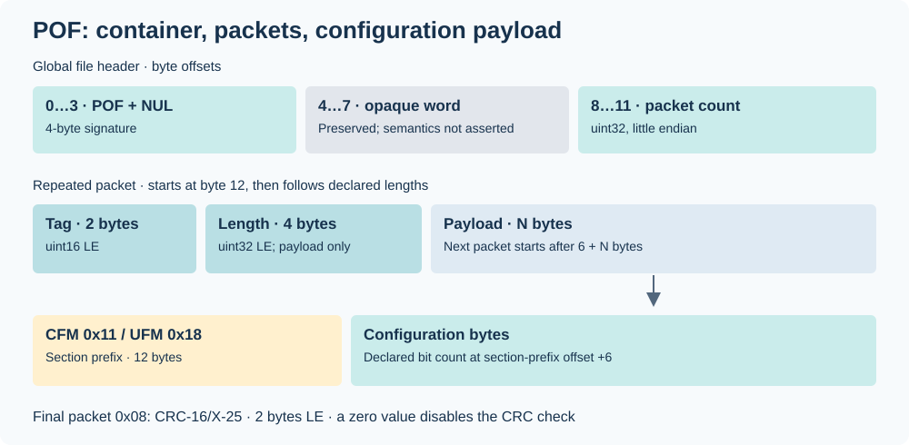
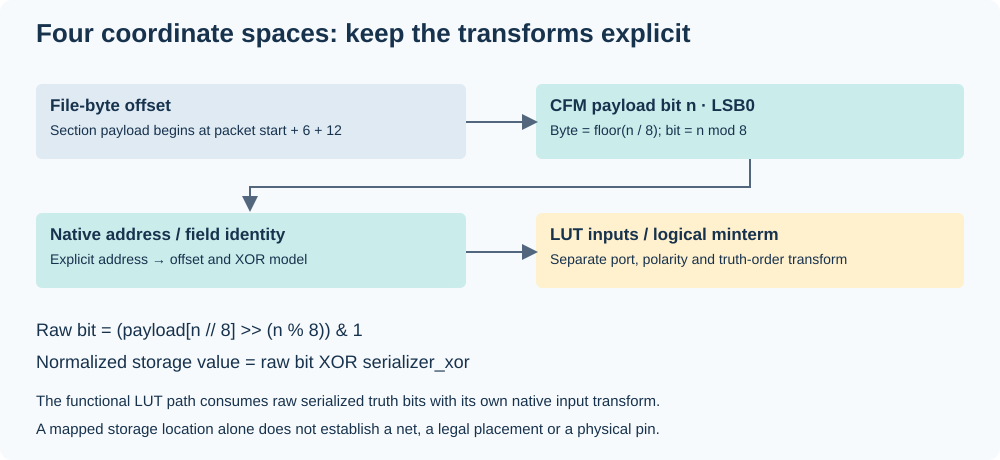
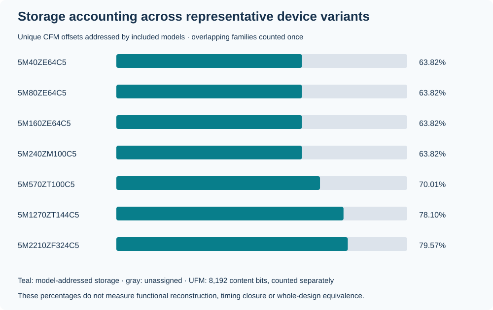

# POF structure and configuration bit addressing

A POF is a packet container. Parsing the container, reading configuration storage
and reconstructing a function are three different operations. MAXVell parses all
packet boundaries; it interprets selected MAX V configuration fields. It does
**not** semantically decode every packet field or every CFM bit.

The historical [POF Format, Code 14](https://download.dataio.com/ftp/main/2939u_book1.pdf#page=163)
appears in Data I/O's 3980/3900/2900 programmer manual, printed pp. 5-9–5-11.
It describes packet headers, historical tags and the terminator for older Altera
MAX devices. It does not specify the modern header word, MAX V section prefix,
UFM tag or the CRC polynomial used below. Those details describe MAXVell's
tested implementation and retained results, not a complete vendor specification.
See [external references](REFERENCES.md#pof-container-and-max-v-hardware).



## Global header and packets

Offsets in this table are file-byte offsets. Multibyte integers are little endian.

| Offset | Size | Meaning in this implementation |
| ---: | ---: | --- |
| 0 | 4 | Magic `50 4F 46 00` (`POF` followed by NUL) |
| 4 | 4 | Opaque header word; retained without asserting its semantics |
| 8 | 4 | Number of packets, unsigned 32-bit integer |
| 12 | Variable | First packet; subsequent packets follow their declared lengths |

Every packet starts with a 2-byte tag and a 4-byte payload length. Length excludes
the six header bytes. A packet beginning at `p` occupies `[p, p + 6 + length)`.
Tags need not be numerically ordered. Unknown packets remain available in the
parser's byte snapshot; no interpretation is invented for them.

The parser rejects truncated headers, payload overruns and trailing bytes.
The public decoder rejects duplicate critical tags 2, 8, 17 and 24. Repeated
noncritical tags remain packet records. Creator/comment content is omitted from
CLI summaries and generated public IR; `inspect` reports offsets and sizes.
The duplicate-critical-tag restriction is this decoder's admission rule; the
historical description permits repeated non-terminator packets more generally.

## Tags and interpretation

Historical tag names describe the container vocabulary, not a promise that all
of their payload semantics apply identically to every MAX V POF.

| Tag | Hex | Container role | Current handling |
| ---: | --- | --- | --- |
| 1 | `0x01` | Creator identification | Packet parsed; text omitted from summaries/IR |
| 2 | `0x02` | Device name | Exact part selects models; die-only names need `--target` |
| 3 | `0x03` | Comment / option text | Packet parsed; text omitted |
| 4 | `0x04` | Reserved tag | Opaque payload |
| 5 | `0x05` | Security packet | Named container role; no complete packet semantic decoder |
| 6 | `0x06` | Logical address/data, 16-bit form | Opaque payload |
| 7 | `0x07` | Electrical address/data | Opaque payload |
| 8 | `0x08` | Terminator / CRC | Two-byte CRC; must be final when present |
| 9 | `0x09` | Symbol table | Opaque payload |
| 10 | `0x0A` | Test vectors | Opaque payload |
| 12 | `0x0C` | Electrical address / constant data | Opaque payload |
| 14 | `0x0E` | Programmable-element count | Opaque payload |
| 17 | `0x11` | MAX V CFM section | Section prefix and selected configuration fields |
| 24 | `0x18` | MAX V UFM section | Section prefix and 8,192-bit content layout |
| Other | — | Unknown extension | Packet bounds parsed; payload remains opaque |

## CFM and UFM section prefix

Offsets below are relative to the packet payload, after its six-byte header.

| Offset | Size | Handling |
| ---: | ---: | --- |
| 0…5 | 6 | Opaque prefix bytes |
| 6…9 | 4 | Declared configuration bit count, uint32 LE |
| 10…11 | 2 | Opaque prefix bytes |
| 12… | Variable | Configuration payload |

The declared count must equal `8 × payload_bytes`. CFM decoding additionally
requires the exact target's model geometry. UFM content requires 1,024 bytes:
512 logical words of 16 bits. A matching payload size alone cannot identify the
package, speed grade, routing semantics or legal placement population.

## CRC

The terminator carries CRC-16/X-25: reflected polynomial `0x8408`, initial
register `0xFFFF`, final XOR `0xFFFF`. It covers all file bytes preceding the
CRC value, including the terminator packet header. Stored CRC zero means the
check is disabled; an absent or disabled CRC is not reported as verified.
The standard test vector `123456789` produces `0x906E`. CRC detects accidental
corruption; it does not authenticate the producer or establish functional validity.

## From bytes to fields



CFM payload bit `n` is LSB0 within its byte:

```python
raw = (payload[n // 8] >> (n % 8)) & 1
normalized = raw ^ serializer_xor
file_byte = packet_header_offset + 6 + 12 + n // 8
```

The native address can be reordered relative to serialized offsets. Models
provide the actual address/offset/XOR binding. A native LUT ordinal, a logical
minterm, an input port and a Quartus `LC_X/Y/N` identity are separate contracts.
The functional path uses raw serialized truth bits with its native input
transform; the storage path exposes normalized ordinal values. Mixing the two
can reverse polarity or change the recovered function.

## Uninterpreted storage



`coverage --target ...` reports the set union of offsets addressed by included
models and the remaining ranges. Some addressed fields are candidates or
diagnostics, and model families overlap. These are storage-accounting numbers,
not percentages of reconstructed functionality. Raw bytes remain in
`maxvell._core.pof.PofFile`; exported storage IR is not a complete POF serializer.
See [status and family tables](STATUS.md) for interpreted fields and consumers.
