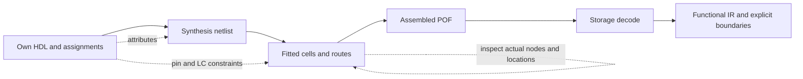

# Controlling Quartus experiments

Use small own designs and inspect what actually survives synthesis and fitting.
There is no single MAX V switch that preserves arbitrary RTL, placement and
routing together. A source attribute, an accepted assignment and a confirmed
post-fit result are three different observations.

This guide includes an own example checked with **Quartus Prime Lite
25.1std.0 Build 1129**, target **5M1270ZT144C5**. Older model observations in
this repository retain their actual [provenance](PROVENANCE.md); the example
does not requalify that catalog for a new compiler version.

## Choose the stage to control



| Goal | Starting point | Check and limitation |
| --- | --- | --- |
| Keep an intermediate combinational wire | `(* keep = 1 *) wire probe_comb;` or `IMPLEMENT_AS_OUTPUT_OF_LOGIC_CELL ON` | Needs meaningful fan-out. Check synthesis **and** final fit; the fitter may still pack its function into a register's cell. |
| Retain a register | `(* preserve *) reg r;` or `PRESERVE_REGISTER ON` | Does not by itself retain a register without fan-out or prove that its physical implementation is unchanged. |
| Prevent merging equivalent registers | `(* dont_merge *) reg r;` or `DONT_MERGE_REGISTER ON` | Check both names and cells. If both already survive the baseline, that experiment does not demonstrate a merging effect. |
| Retain a fan-out-free register | `(* preserve, noprune *) reg orphan;` and `PRESERVE_FANOUT_FREE_NODE ON` | Check its final fitted cell. The example's intentional unused-register warning remains even when the cell is retained. |
| Limit later netlist/physical transformations | Disable `PHYSICAL_SYNTHESIS_COMBO_LOGIC`, `PHYSICAL_SYNTHESIS_REGISTER_DUPLICATION`, `PHYSICAL_SYNTHESIS_REGISTER_RETIMING`; set `ADV_NETLIST_OPT_ALLOWED "NEVER ALLOW"` | These form the tested example's profile. They are not a universal optimization freeze, nor was each switch's individual effect established. |
| Keep package pins fixed | `set_location_assignment PIN_18 -to clk`, matching `IO_STANDARD` | Validate the exact package, legal clock/input/output roles and board voltage. Confirm final pin rows; a similarly named device is insufficient. |
| Keep surviving registers at exact cells | `set_location_assignment LC_X1_Y10_N6 -to r0` | Start with actual fitted node names and legal locations. Refit and compare the new location export. An LC lock does not freeze its routes. |
| Repeat a fitter starting point | Same tool, settings and `SEED` | A seed is not a lock or a guarantee of identical results across versions. Test repeatability independently. |
| Restrict a region or resource class | LogicLock/region controls or per-net global-resource assignments supported by the installed edition/device | Confirm availability, accepted assignments and actual resource use. The Lite example does not establish LogicLock support. |
| Expose a node for observation | An own output/probe or a supported Signal Probe workflow | Adding a probe changes fan-out and can change packing, placement and routing. It needs its own comparison. |

The vendor describes [keep](https://docs.altera.com/r/docs/683283/18.1/design-compilation-user-guide-quartus-prime-standard-edition/keep-combinational-node/implement-as-output-of-logic-cell?contentId=4ZtpsWy4RIS0OK2_DXmxcg),
[preserve](https://docs.altera.com/r/docs/683283/18.1/design-compilation-user-guide-quartus-prime-standard-edition/preserve-registers?contentId=IRCC6xulkf3Mn2pXjN103w),
[dont_merge](https://docs.altera.com/r/docs/683283/18.1/design-compilation-user-guide-quartus-prime-standard-edition/disable-register-merging/don-t-merge-register?contentId=~GWefe2g5Owp8J5~FeeaPw)
and [noprune](https://docs.altera.com/r/docs/683283/18.1/design-compilation-user-guide-quartus-prime-standard-edition/noprune-synthesis-attribute/preserve-fan-out-free-register-node?contentId=7a3Q8BCr3M7jB~0KMTQ1DA)
separately. Check the installed version's help rather than assuming all Pro/FPGA
options apply to MAX V.

## Run the own example

Install your own permitted Quartus toolchain with MAX V device support; see
[matching installers and device packages](REFERENCES.md#get-the-tools). Put its
`quartus_sh` and `quartus_cdb` executables on PATH. The ordinary MAXVell runtime
does not require them. The following PowerShell commands run from the checkout
root; generated files stay in the ignored `work/` directory.

```powershell
python examples/quartus_control/setup.py --out work/control_demo
$inspector = (Resolve-Path examples/quartus_control/inspect_fit.tcl).Path

Push-Location work/control_demo/baseline
quartus_sh --flow compile baseline -c baseline
if ($LASTEXITCODE -ne 0) { throw "Baseline compile failed" }
quartus_cdb -t $inspector baseline
if ($LASTEXITCODE -ne 0) { throw "Baseline inspection failed" }
Pop-Location

Push-Location work/control_demo/controlled
quartus_sh --flow compile controlled -c controlled
if ($LASTEXITCODE -ne 0) { throw "Controlled compile failed" }
quartus_cdb -t $inspector controlled
if ($LASTEXITCODE -ne 0) { throw "Controlled inspection failed" }
Pop-Location
```

`setup.py` requires an empty output directory and invokes no vendor software.
It creates separate baseline and controlled projects from
[design.v](../examples/quartus_control/design.v). Both sample `a ^ b` into `r0`
and `r1`, connected to `q0` and `q1`. A third register, `orphan`, has no fan-out.
The controlled project adds the attributes and assignments above. This is a
**combined control-profile experiment**, not a one-factor attribution test.

For the checked target the generator fixes `a=PIN_4`, `b=PIN_2`, `clk=PIN_18`,
`q0=PIN_6`, `q1=PIN_5`, with 3.3-V LVTTL. Unused pins are reserved as inputs
tri-stated. These are experimental constraints, not a board pinout. The SDC
specifies a 20 ns clock and illustrative input/output delays; it does not
establish the timing of a connected board. There is no reset: source behavior
is defined after a sampling clock event, not by an assumed power-up state.

`--target` can generate another exact part, but only the default target receives
this pin map. Supply and check legal pins, voltage and timing for any other part
before drawing a controlled comparison. Such alternate fits were not tested.

The inspection script reads your own fitted netlist. It prints fitted LC names
and writes `node_loc.loc` in that project directory. In the checked 25.1 API,
`get_node_loc` takes **no `-file` option**. Synthesis and fitter reports are under
`output_files/`; inspect their resources, messages, node names and pin rows.

## Lock the observed cells and check again

After inspecting the controlled fit:

```powershell
python examples/quartus_control/lock_from_fit.py --project work/control_demo/controlled --out work/control_demo/locked
Push-Location work/control_demo/locked
quartus_sh --flow compile controlled -c controlled
if ($LASTEXITCODE -ne 0) { throw "Locked compile failed" }
quartus_cdb -t $inspector controlled
if ($LASTEXITCODE -ne 0) { throw "Locked inspection failed" }
Pop-Location

$before = Get-Content work/control_demo/controlled/node_loc.loc | Where-Object { $_.Trim() -and -not $_.StartsWith('#') }
$after = Get-Content work/control_demo/locked/node_loc.loc | Where-Object { $_.Trim() -and -not $_.StartsWith('#') }
if (Compare-Object $before $after) { throw "Fitted node locations changed" }
```

The helper accepts this example's three distinct register names and locations,
copies only its HDL/SDC/QPF/QSF, and appends the three LC locks. It copies no
compiled database and does not run Quartus. It is deliberately not a general
back-annotation engine. The new compile must still confirm each requested node,
cell, pin and control; passing the text comparison does not validate routes or
functional equivalence.

The checked fresh fit retained all three requested placements:

| Node | Requested and observed LC |
| --- | --- |
| `r0` | `LC_X1_Y10_N6` |
| `r1` | `LC_X1_Y10_N9` |
| `orphan` | `LC_X2_Y9_N0` |

These locations belong to the recorded fit. Generate your own locks from your
own fit rather than treating them as universal coordinates for these functions.

## Observed result and remaining boundaries

| Observation | Baseline | Controlled | Controlled with LC locks |
| --- | ---: | ---: | ---: |
| Synthesis logic elements | 3 | 4 | 4 |
| Synthesis registers | 2 | 3 | 3 |
| Fitted logic elements | 2 | 3 | 3 |
| Fitted registers | 2 | 3 | 3 |
| Final named registers | `r0`, `r1` | `r0`, `r1`, `orphan` | `r0`, `r1`, `orphan` |
| Full compilation | 0 errors, 5 warnings | 0 errors, 5 warnings | 0 errors, 5 warnings |

The profile retains `orphan`; the combinational XOR is still packed into the
register implementation. Both visible registers survive the baseline, so this
case cannot establish an individual `dont_merge` effect. Each compile reports
the intentional unused `orphan` (10036), one-processor notices (12473, three
occurrences), and a LogicLock subscription notice (292013). No LogicLock region
is requested here. None of these messages was hidden as a warning-free result.
No ignored/unknown control assignment was observed; the fitted pins matched.

You can inspect the resulting POF with MAXVell:

```sh
python -m maxvell inspect work/control_demo/controlled/output_files/controlled.pof --target 5M1270ZT144C5
python -m maxvell reconstruct work/control_demo/controlled/output_files/controlled.pof --target 5M1270ZT144C5 --out work/control_demo/functional_ir.json
```

For the checked controlled POF, CRC and target/section geometry pass. The current
functional reconstruction closes **one register and one nonconstant output
path** (`q0`, pin 6); `q1` (pin 5) remains boundary
`LC_X1_Y10_N9:REGOUT`, reason **`nonconstant data needs cone composition`**.
Thus successful fitting and storage decoding do not establish whole-design
reconstruction. The example supplies a concrete development case; it does not
claim that both original outputs were independently recovered or compared in
hardware. [Verification scope](CHECKS.md#own-quartus-control-example).

## Routing and saved ECO experiments

### Measured routing back-annotation scope

A separate own study used **six explicitly placed LCs and nine fixed pins** on
**5M1270ZT144C5**, with Quartus II **13.1.4 Build 182 Web Edition** and Quartus
Prime **25.1std.0 Build 1129 Lite Edition**. This fixture is distinct from the
register-preservation starter above. Retained results show both builds exporting
and consuming an RCF for that fixture, despite installed command help listing
other families:

```sh
quartus_cdb probe --back_annotate=routing
```

Here `probe` is the fitted project/revision used in the study; use your own actual
project names. Keep the generated RCF **and modified QSF**, including placement,
delay assignments and changed atom/net aliases. Rebuild in a fresh directory from
HDL, QPF, QSF, SDC and RCF, without the previous fitted database. The tested QSF
uses `ROUTING_BACK_ANNOTATION_FILE probe.rcf`; 13.1 also emitted
`ROUTING_BACK_ANNOTATION_MODE NORMAL`, while 25.1 did not emit that mode line.

All **18 positive cases** realized **25/25 requested paths per case**. All **12
negative/stale cases** compiled successfully but failed the fixture's independent
route checks. Missing RCF, invalid resources, missing placement and stale source
references can trigger fallback; some diagnostics are only informational.
**Exit code zero does not establish that routing constraints were honored.**

Check each requested source, physical destination, `route_port` and fitted
resource sequence. Logical `dest` and physical `route_port` are distinct; LUT
input permutation needs a matching truth-mask transform. A complete signal block
from a known realized alternative can provide a controlled route change; check
branches, destinations, resource conflicts and all affected/unaffected paths.
LC locks, equal seeds and regional placement alone do not freeze routes.

These results establish the tested builds/device/fixture, not arbitrary-PIP API
support, a complete routing-legality database or general device compatibility.
The fixture checker is not a universal RCF validator. Deliberately tight 2-ns
cases failed timing. The study compared 28 exported post-fit netlists in 1,792
untimed functional checks; SDF, hardware and whole-original-POF equivalence were
not established. These are retained results, not new compiler runs for this
documentation update.

### Save an ECO and verify the saved state

Work on a copy of an own fitted project **including its database**. The tested
mask edit below deliberately changes the function. Replace project/node names
with the actual fitted identities; it is not an edit for the starter project:

```tcl
package require ::quartus::project
package require ::quartus::chip_planner
project_open probe -revision probe
read_netlist
set dst [get_node_by_name -name "|top|target0"]
if {$dst == -1} { error "required fitted node missing" }
if {![set_node_info -node $dst -info "Sum LUT Mask" 9669]} { error "mask edit failed" }
if {![check_netlist_and_save]} { error "ECO save failed" }
project_close
```

Save the snippet as your own Tcl script and run `quartus_cdb -t own_eco.tcl`
from the copied fitted project directory. It mutates that copy's saved netlist.

The tested mask spelling is four hexadecimal characters without `0x`; its meaning
depends on physical LUT input order. Reopen in a fresh process to inspect saved
nodes, masks, connections and routes. Run `quartus_sta probe -c probe` and
`quartus_asm probe -c probe`, inspect timing, decode the newly assembled POF and
compare the changed function with an independent oracle. Eight final retained
ECO cases passed the saved-state checks after reopening, STA and assembly.

For routing queries, `set_batch_mode on` followed by `set_batch_mode off` **before
editing/saving** avoided retained query/save crashes. In these builds,
`check_netlist_and_save` performed ECO processing; an extra `quartus_fit probe
--eco` afterward failed with message 11750 because no pending fitter ECO remained.
A clean RTL compile restored the HDL's original mask/function: RCF constrains
requested routes; it does not retain an ECO's changed logic. Update authoritative
HDL or explicitly reapply and verify an ECO after a new fit. Do not generalize
this mask setter to other devices or modes from one example.

The register starter does **not** test ECO edits. See the vendor's
[ordinary-compilation/ECO guidance](https://docs.altera.com/r/docs/683283/18.1/design-compilation-user-guide-quartus-prime-standard-edition/signal-probe-pins-and-engineering-change-orders?contentId=EHmCF_RYVo9nTvTV37FQRA)
and the [verification boundaries](CHECKS.md#retained-routing-and-eco-observations).

### Limits of reversal

If an optimization removed information, the practical remedy is to rerun your
own source with suitable controls and verify the new fit. A POF alone does not
uniquely recover eliminated RTL names, dead logic or the original decomposition
of equivalent functions. ECO cannot restore information absent from its input.

## Checks before using a result as evidence

- Record tool version, exact target, source/settings/stimulus hashes and the
  behavior being tested. Keep the baseline separate.
- Check legal pins, timing assumptions, cell identities and actual node names.
  Native decoder coordinates need a checked transform before becoming placement
  identities; see [IR contracts](ARCHITECTURE.md).
- Stop on ignored/unknown assignments, a missing required node, a moved required
  cell or pin, conflicting controls, or unexplained functional differences.
- Inspect both synthesis and final fit. For a four-input LUT claim, confirm all
  four fitted port bindings and their logical order, not merely the LC location.
- Re-decode the freshly assembled POF and compare the relevant function with an
  independent oracle. A previous fit or decoder/encoder round trip cannot grant
  equivalence to a new input.

Avoid unverified aliases such as `BUS_HOLD`, `OPEN_DRAIN_OUTPUT`, `SLEW_RATE`
and `AUTO_REGISTER_DUPLICATION`. Use the installed tool's accepted names and
confirm their effect. `DONT_SWEEP_WYSIWYG` and
`PRESERVE_FANOUT_FREE_WYSIWYG` were rejected in retained Quartus II 13.1 MAX V
experiments; they are not a portable preservation recipe.

For discriminating experiments, contradiction handling and evidence scope,
continue with [EXPERIMENTS](EXPERIMENTS.md).
