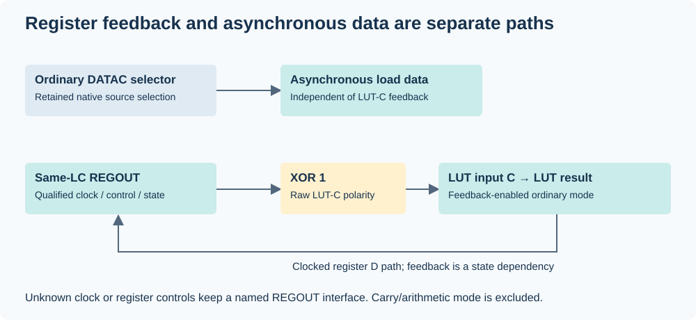

# Functional reconstruction

`reconstruct` follows native configuration predicates and creates a partial
functional graph. The same graph drives simulation and HDL emission. It does
not need fitted signal names, an expected circuit shape or external test files.

## LUT and pin cones

The decoder reads raw serialized truth bits under the included native input
transform. It follows influential LUT inputs only: algebraically unused inputs
can be eliminated without asserting a physical connection. Input selectors,
source COMBOUT/REGOUT roles and native route identities remain separate stages.

Routing distinguishes zero, unique, multiple and unknown matches. A unique
candidate can be followed within the bounded model class. Missing alternatives,
unsupported terminals and cyclic combinational dependencies produce named cuts.
Normal IO mux paths and direct bypass paths are examined separately. DATA and OE
are composed before push-pull/open-drain behavior is applied. Sampling a pad does
not prove how an external board drives it.

## Registers and controls

Ordinary internal feedback selects same-LC register state at raw LUT input C,
with XOR 1 under the retained raw truth ordering. Its ordinary DATAC selector
can independently provide asynchronous load data; only the LUT consumer is
overridden. A COMBOUT-only output may therefore still depend on hidden state.

Qualified registers carry explicit clock pin/edge, Enable, Clear, Load and async
data. Boolean control LUTs are budgeted and restricted to ordinary mode. The
state-sourced async-control class permits one source layer, one state source,
opposite edges of a common primary clock and pin-only async data/Enable.
Unsupported combinations stay unresolved. These guards are part of the consumer.

The evaluator handles settled binary single-input events. Clear dominates Load,
then an enabled selected clock edge updates D. It settles state-sourced async
consumers after sampled clock updates. Initial state must be supplied and already
consistent with active async controls. Startup, timing and simultaneous-input
behavior are outside this model.

## Reading a result

`assessment.metrics` distinguishes:

- `closed_nonconstant_output_paths`: driven outputs with no unknown dependency;
- `closed_register_models`: modeled state with no unresolved control/data input;
- `open_interfaces`: remaining cuts, each with its reason;
- released pins and constant drive relations, reported separately.

“Closed” refers to the represented dependency graph and its model assumptions.
It does not prove that every original POF function is represented. A draft may
have both closed cones and open interfaces. `--output-pin PIN` selects only
closed driven cones and retains their required sampled inputs; an unresolved
selection is rejected.

## UFM

`ufm` exports content as words/MIF. A recipe classifier additionally checks exact
target, packet IDs/lengths, section prefixes and CFM content. UFM payload content
can vary within a matched recipe. Nine included recipes cover serial `maxv_ufm`
and parallel `altufm_parallel` interfaces on seven exact targets. An unmatched
CFM still permits content extraction but blocks recipe project emission.

Recipe drafts expose the declared primitive interface. They do not infer the
surrounding logic, external protocol or a new fitted-equality
grant. Primitive definitions and Quartus compilation are supplied by the user's
toolchain; vendor implementation files are not included.

Pin constraints are optional. Functional drafts use the exact target's bonded
native-IO/package join; serial UFM drafts use the included recipe's test-interface
map. `--bind-pins` checks these bindings before writing a project. Parallel UFM
recipes have no included physical map. No new placement or compile proof follows
from copying these assignments.

## LUT-only and functional mask contracts

By default, `emit-lut` consumes the dedicated logical-minterm view for
`5M40ZE64C5` and `5M80ZE64C5` and creates isolated cell modules with unresolved
inputs. Explicit `--view retained-topology` also exports the 570 cells of
`5M570ZT144C5` or the 2,210 cells of `5M2210ZF324C5` under their retained
minterm relabels. These modules preserve the conditional cell truth tables;
their input topology and source connectivity remain unproved. They do not
reconstruct the original interconnect, collector or pin function. See the
[commands](USAGE.md) and [candidate boundaries](CANDIDATES.md).

`reconstruct` consumes the native functional transform and can build LUT/state/pin
cones from the broader context catalog. A normalized native ordinal mask is not
interchangeable with a logical-minterm or retained-topology mask.
